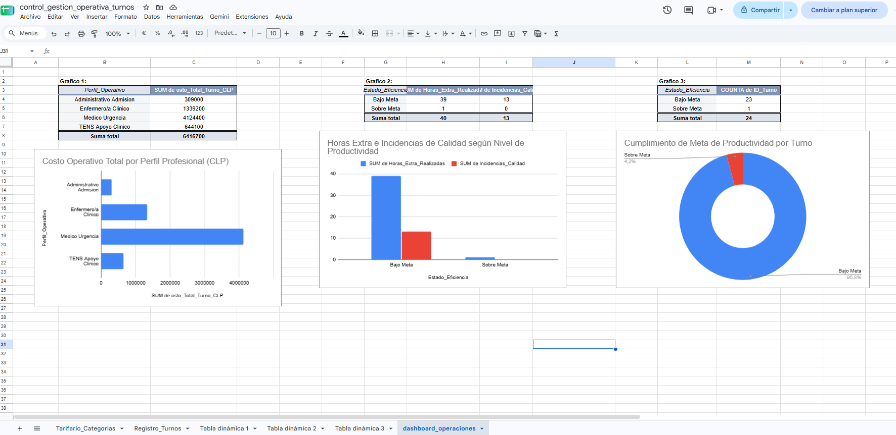

# Control de Gestión Operativa, Costos y Eficiencia de Turnos

## 🎯 Objetivo del Proyecto
Modelar un sistema de control de gestión operativa y presupuestaria para turnos de urgencia, integrando tablas relacionales mediante funciones de búsqueda (`BUSCARV`) y lógica condicional (`SI`) para evaluar costos de horas extra, productividad por rol e incidencias de calidad.

## 🛠️ Herramientas Utilizadas
* **Google Sheets / Excel:** Modelado relacional entre tablas maestras y operativas (`BUSCARV`, `SI`), cálculo de KPIs financieros y operativos, tablas dinámicas y dashboard ejecutivo.

## 💡 Principales Hallazgos Operativos
* **Estructura Presupuestaria:** El gasto operativo total del período ascendió a **$6.416.700 CLP**, concentrándose en el estamento **Médico de Urgencia ($4.124.400 CLP)** y **Enfermería Clínica ($1.339.200 CLP)**.
* **Correlación entre Fatiga, Productividad e Incidencias:** El **100% de las incidencias de calidad registradas (`13` eventos)** y **39 de las 40 horas extra realizadas** ocurrieron en turnos que operaron bajo la meta teórica de productividad (`Bajo Meta`), evidenciando que extender jornadas no compensa la sobrecarga asistencial y aumenta el riesgo operativo.
* **Brecha de Productividad:** El **95,8% de los turnos (`23` de `24`)** operó bajo la meta teórica de atenciones por hora, respaldando la necesidad de redistribuir dotación hacia bloques de alta demanda en lugar de recurrir a horas extra.

### Vista Previa del Dashboard

